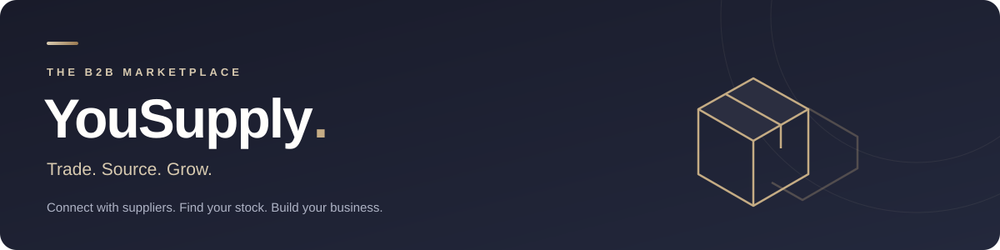



<p align="center">
  <strong>A simpler way to source, sell, and grow.</strong><br />
  Wholesale discovery and ordering for buyers and suppliers.
</p>

<p align="center">
  <a href="#overview">Overview</a> &nbsp; · &nbsp;
  <a href="#get-started">Quick start</a> &nbsp; · &nbsp;
  <a href="#development">Development</a> &nbsp; · &nbsp;
  <a href="#troubleshooting">Troubleshooting</a>
</p>

---

## Overview

YouSupply brings business buyers and suppliers together in one marketplace. Discover products across categories, see prices and order minimums upfront, and manage purchases from checkout to fulfillment.

**Status:** MVP in development &nbsp; · &nbsp; **Stack:** React / Vite / Express / MongoDB

### One marketplace. Three workspaces.

| Buyers | Suppliers | Administrators |
| :--- | :--- | :--- |
| Discover and compare products | Publish and update listings | Review supplier applications |
| Build a cart and place orders | Manage prices and inventory | Manage accounts and categories |
| Track purchases and notifications | Process incoming orders | Oversee products and orders |

### From discovery to delivery

**01 Browse** → **02 Add to cart** → **03 Review & order** → **04 Track fulfillment**

- **Flexible buying:** wholesale and single-item listings with minimum order quantities.
- **Inventory checks:** checkout validates stock and current prices before creating an order.
- **Order visibility:** purchase agreements, order history, and item fulfillment updates.
- **Multiple categories:** fashion, electronics, beauty, home, groceries, and more.

> **Payments:** Cash on Delivery is supported alongside Zaad and eDahab demo flows. Demo payments do not transfer money.

## Get started

### Before you begin

- Install Node.js and npm compatible with the package versions in [frontend/package.json](frontend/package.json) and [backend/package.json](backend/package.json).
- Install MongoDB Community Server for the local database helper, or use a MongoDB deployment that supports transactions, such as an Atlas cluster.
- Open a terminal in the repository root. The commands below use **PowerShell**.

> **Database requirement:** A standalone MongoDB instance will be rejected by the backend. Use the included replica set helper or a transaction-capable replica set / sharded deployment.

### 1. Install dependencies and copy configuration

```powershell
cd backend
npm ci
Copy-Item .env.example .env
cd ../frontend
npm ci
Copy-Item .env.example .env
cd ..
```

If you already have `.env` files, keep them and compare their settings with the examples instead of copying over them.

### 2. Set your environment variables

Edit `backend/.env`:

```dotenv
PORT=5000
MONGO_URI=mongodb://127.0.0.1:27018/p2p?replicaSet=p2p-rs
JWT_SECRET=replace_with_your_generated_secret
NODE_ENV=development
CLIENT_URL=http://localhost:5173
```

Generate a random secret with the command below and paste its output into `JWT_SECRET`. The backend requires at least **32 characters** and rejects the example file's placeholder.

```powershell
node -e "console.log(require('node:crypto').randomBytes(32).toString('hex'))"
```

Edit `frontend/.env`:

```dotenv
VITE_API_URL=http://localhost:5000/api
```

| Setting | Purpose |
| :--- | :--- |
| `PORT` | Port the Express server listens on |
| `MONGO_URI` | Connection string for a transaction-capable MongoDB deployment |
| `JWT_SECRET` | Secret used to sign and verify authentication tokens |
| `NODE_ENV` | Backend environment; use `development` locally |
| `CLIENT_URL` | Frontend origin allowed by the API's CORS configuration |
| `VITE_API_URL` | API base URL used by the frontend |

Keep backend secrets out of version control. Values prefixed with `VITE_` are exposed to the browser.

### 3. Start the local database

In a terminal from the repository root:

```powershell
cd backend
npm run db:local
```

Wait for **YouSupply local MongoDB ready** and keep the terminal open. The helper starts a persistent, single-node replica set named `p2p-rs` on port **27018**, storing its data in `backend/.mongo-data/`. Press `Ctrl+C` to stop it.

<details>
<summary><strong>Using Atlas or a custom MongoDB executable?</strong></summary>

For Atlas or an existing transaction-capable deployment, replace `MONGO_URI` with your connection string and skip `npm run db:local`. Ensure your database credentials and network access allow a connection.

The local helper uses `mongod` from your PATH and also checks standard MongoDB installation directories on Windows. To specify the executable yourself:

```powershell
cd backend
$env:MONGOD_BINARY = 'C:\path\to\mongod.exe'
npm run db:local
```

</details>

### 4. Start the API and frontend

Open **two more terminals**, each starting in the repository root.

**Terminal 2 — API**

```powershell
cd backend
npm run dev
```

**Terminal 3 — frontend**

```powershell
cd frontend
npm run dev
```

| Open | Local address |
| :--- | :--- |
| Marketplace | [localhost:5173](http://localhost:5173) |
| API health check | [localhost:5000/api/health](http://localhost:5000/api/health) |

The health endpoint should return:

```json
{ "success": true, "message": "YouSupply API is running" }
```

### 5. Try the marketplace

1. Open the marketplace and register as a **buyer** or **supplier**.
2. As a supplier, complete your profile. Publishing products requires supplier approval by an administrator.
3. As a buyer, browse available products, add items to your cart, and review checkout.
4. Accept the current purchase agreement, place an order, and follow its fulfillment status.

Public registration supports buyer and supplier roles. Administrator access requires an existing administrator account; it cannot be selected through public registration. A new database needs categories and approved supplier listings before you can exercise the full shopping flow.

## Development

### Useful commands

Run each command from the directory shown.

| Directory | Command | What it does |
| :--- | :--- | :--- |
| `backend` | `npm run db:local` | Start the local MongoDB replica set |
| `backend` | `npm run dev` | Start the API with automatic restarts |
| `backend` | `npm start` | Start the API without nodemon |
| `backend` | `npm test` | Run the backend test suite |
| `frontend` | `npm run dev` | Start the Vite development server |
| `frontend` | `npm run build` | Build frontend assets for production |
| `frontend` | `npm run preview` | Preview the built frontend locally |
| `frontend` | `npm run lint` | Run Oxlint |
| `frontend` | `npm test` | Run the standard Playwright suite |
| `frontend` | `npm run test:ui` | Open the Playwright test UI |
| `frontend` | `npm run test:registration` | Run the live registration test |

For browser tests, install Chromium once from `frontend` with `npx playwright install chromium`. The standard Playwright configuration starts or reuses a frontend server at `http://127.0.0.1:5173`; live registration tests also require the API and database to be running.

<details>
<summary><strong>API reference</strong></summary>

### API entry points

All paths below are relative to `/api`. Individual routes enforce their own authentication and role requirements.

| Path | Responsibility |
| :--- | :--- |
| `/health` | Server health response |
| `/auth` | Registration, login, current user, and notifications |
| `/products` | Public catalog and approved supplier listing management |
| `/categories` | Public categories and administrator category management |
| `/suppliers` | Supplier directory, profiles, images, and supplier orders |
| `/orders` | Purchase agreement, buyer orders, and item fulfillment |
| `/admin` | Account status, supplier verification, products, and orders |

Start exploring in [backend/server.js](backend/server.js), [frontend/src/App.jsx](frontend/src/App.jsx), and [frontend/src/services/api.js](frontend/src/services/api.js).

</details>

## Troubleshooting

| Symptom | What to check |
| :--- | :--- |
| API refuses to start with a JWT error | Set a random `JWT_SECRET` of at least 32 characters and restart the API. |
| MongoDB connection fails | Check `MONGO_URI`, start the local helper, or verify Atlas credentials and network access. |
| Backend requires a replica set | Use `npm run db:local` and the example URI on port `27018`, or a transaction-capable deployment. |
| Local MongoDB helper cannot start | Install MongoDB, check `MONGOD_BINARY`, ensure port `27018` is free, and inspect `backend/.mongo-data/mongod.log`. |
| Frontend cannot reach the API | Open the health endpoint and check `VITE_API_URL`. Restart Vite after changing its environment file. |
| Browser blocks an API request | Match `CLIENT_URL` to the frontend origin, including its port, and restart the API. |
| Supplier cannot publish a product | Check that the supplier profile has been approved by an administrator. |
| Catalog is empty | Add categories and active products from approved suppliers; a fresh database has no listings. |

## Roadmap

- [ ] Expand end-to-end coverage of buyer and supplier workflows.
- [ ] Refine mobile layouts and product imagery.
- [ ] Integrate a live payment provider.
- [ ] Add production deployment configuration and monitoring.

---

<p align="center"><strong>YouSupply</strong> &nbsp; · &nbsp; Trade. Source. Grow.<br /><a href="#">Back to top ↑</a></p>
